<p align="center">
  <picture>
    <source media="(max-width: 1011px) and (prefers-color-scheme: dark)" srcset=".github/assets/hero-narrow-dark.svg">
    <source media="(max-width: 1011px)" srcset=".github/assets/hero-narrow-light.svg">
    <source media="(prefers-color-scheme: dark)" srcset=".github/assets/hero-dark.svg">
    
  </picture>
</p>

<p align="center">
  A skill for <b>Claude Code</b>, <b>Codex</b> and <b>ChatGPT</b> that redesigns a GitHub repo's README into a page that sells the project
  in its first screen and then proves it, with animated visuals in light and dark, at desktop and phone widths, that play right on github.com.
</p>

<p align="center">
  <a href="#install">Install</a> ·
  <a href="#does-it-work">Results</a> ·
  <a href="#how-it-works">How it works</a> ·
  <a href="#made-with-it">Made with it</a> ·
  <a href="evals/">Evals</a>
</p>

<br>

Point it at a repo, public or private, and ask for a better README. It reads the code, finds what the project can actually prove, gives the page a look taken from the project's own world, and builds the visuals. Then it shows you the old and new READMEs side by side before anything gets pushed.

## Does it work?

<picture>
  <source media="(max-width: 1011px) and (prefers-color-scheme: dark)" srcset=".github/assets/proof-narrow-dark.svg">
  <source media="(max-width: 1011px)" srcset=".github/assets/proof-narrow-light.svg">
  <source media="(prefers-color-scheme: dark)" srcset=".github/assets/proof-dark.svg">
  
</picture>

I ran the same prompt on three of my repos with and without the skill. The plain model made good-looking images, but none of them had a phone version, one repo got no dark version, and one run drew numbers it had made up. With the skill, every visual came in light, dark and phone versions, every run ended with a before/after, and the visuals were built from each repo's real results and output.

> [!NOTE]
> One run per repo, graded by script and by reading the outputs. The skill costs about 1.6× the tokens and 1.7× the time. Every check and its evidence is in [`evals/`](evals/).

## Install

**Claude Code**

```bash
git clone https://github.com/rader-ai/github-readme-designer.git
cp -r github-readme-designer/skills/github-readme-designer ~/.claude/skills/
```

<details>
<summary>Codex, ChatGPT and Claude apps</summary>

- **Codex:** copy `skills/github-readme-designer` to `~/.agents/skills/` (or `.agents/skills/` in a project).
- **ChatGPT and Claude apps:** zip the `skills/github-readme-designer` folder and upload it as a skill. ChatGPT reads your repo through its GitHub connector (or a zip you upload) and hands back a zip with the README, the images and the before/after page, since it can't push.

</details>

Then ask in plain words: *"redesign the README for rader-ai/my-repo"*, *"my README is boring, make it sell"*, or *"this repo has no README, write one"*.

## How it works

<picture>
  <source media="(max-width: 1011px) and (prefers-color-scheme: dark)" srcset=".github/assets/flow-narrow-dark.svg">
  <source media="(max-width: 1011px)" srcset=".github/assets/flow-narrow-light.svg">
  <source media="(prefers-color-scheme: dark)" srcset=".github/assets/flow-dark.svg">
  
</picture>

1. **Reads the repo:** code, docs, examples, eval results, sample data and the current README, which it saves for the before/after.
2. **Finds the proof.** Real numbers from the repo, and real output: if the project ships sample data and it's safe to run, it runs it and shows what actually comes back. It never invents numbers, and if the code isn't there it tells you instead of guessing.
3. **Picks a look from the project's world** (a lighthouse for a Lighthouse tool, a cutting mat for a design tool) and one signature animation that shows what the project does.
4. **Builds the visuals** as self-contained animated SVG files: light and dark, desktop and phone. GitHub strips scripts and styles from READMEs, but image files keep their CSS animation, so the motion plays right on the page.
5. **Checks, then shows you a before/after.** A lint for anything GitHub would strip, a headless-browser check for text that runs off the edge at any point in the loop, and a page that renders the old and new READMEs side by side through GitHub's own Markdown API. Pushing is your call.

## Made with it

<picture>
  <source media="(max-width: 1011px) and (prefers-color-scheme: dark)" srcset=".github/assets/examples/lighthouse-fix-hero-narrow-dark.svg">
  <source media="(max-width: 1011px)" srcset=".github/assets/examples/lighthouse-fix-hero-narrow-light.svg">
  <source media="(prefers-color-scheme: dark)" srcset=".github/assets/examples/lighthouse-fix-hero-dark.svg">
  
</picture>

**[rader-ai/lighthouse-fix](https://github.com/rader-ai/lighthouse-fix)** went from all text to a sweeping-beam hero, a looping results chart, and a three-step walkthrough built from a real run of the tool. Its [before](skills/github-readme-designer/examples/lighthouse-fix/README.before.md) and [after](skills/github-readme-designer/examples/lighthouse-fix/README.after.md), the build scripts and the design notes are in [`examples/lighthouse-fix/`](skills/github-readme-designer/examples/lighthouse-fix/). This README was made with it too, starting from no README at all; its build script is [`.github/readme/build.py`](.github/readme/build.py).

<details>
<summary><b>What's in this repo</b></summary>

```
skills/github-readme-designer/
  SKILL.md                     the workflow
  references/                  what GitHub renders, README patterns, motion recipes, platforms
  scripts/svgkit.py            helpers for animated, GitHub-safe SVGs (no dependencies)
  scripts/lint_readme.py       anything GitHub would strip, missing variants, alt text
  scripts/check_bounds.py      text that runs off the edge, across the whole loop (headless Chrome)
  scripts/preview.py           the before/after page, rendered by GitHub's Markdown API
  examples/lighthouse-fix/     a complete worked example
evals/                         test cases, grader and results
.github/readme/build.py        how this README's visuals were made
```

</details>

<details>
<summary><b>Limits</b></summary>

- Image SVGs can't load web fonts, so type uses system font stacks and looks slightly different on each OS.
- GitHub picks images by window width and theme when the page loads. Light/dark switching hasn't been verified in the GitHub mobile apps or Safari.
- Video plays on GitHub only when uploaded through the web editor, so the skill sticks to SVG (and keeps any GIFs a repo already has).
- Tested on three repos so far, one run each.

</details>
